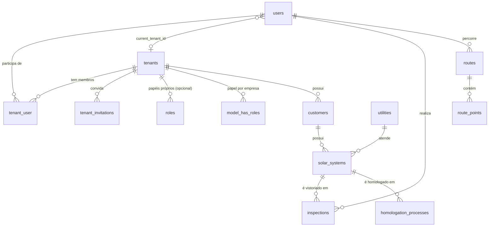

# 03. Modelo de dados

## 1. Classificação das tabelas

Toda tabela cai em uma de três categorias. A categoria decide se ela tem `tenant_id` e se o model usa o trait `BelongsToTenant` ([doc 04](04-implementacao-backend.md)).

| Categoria | `tenant_id` | Tabelas |
|---|---|---|
| **Plataforma** | Não | `tenants`, `plans` (fase 6), `b2b_clients` (fase 6), `users`, `tenant_user`, `password_reset_tokens`, `sessions`, `cache`, `cache_locks`, `jobs`, `job_batches`, `failed_jobs`, `permissions` |
| **Referência global** | Não | `utilities` (concessionárias de energia), `states` e `cities` (IBGE) e, conforme a decisão 3 do [README](README.md#decisões-em-aberto), `equipment_manufacturers` e `equipment_models` |
| **De pacote, com empresa** | Sim, com regra própria | `roles` (`tenant_id` nulo = papel global), `model_has_roles`, `model_has_permissions`, `audits` (nulo = ação da plataforma), `personal_access_tokens` |
| **Da empresa** | Sim, `NOT NULL` | Todo o domínio: clientes, sistemas, vistorias, processos, estoque, agenda, rotas, arquivos e convites |

Regra prática: se a pergunta "de qual empresa é esta linha?" tem resposta, a tabela leva `tenant_id`, **inclusive as tabelas filhas** (`inspection_answers`, `route_points`, `stock_movements`). Repetir a coluna nas filhas custa pouco e evita depender de *joins* para filtrar, exportar ou apagar uma empresa.

## 2. Tabelas novas da tenancy

### `tenants`

| Coluna | Tipo | Notas |
|---|---|---|
| `id` | bigint PK | |
| `name` | string | Nome fantasia, mostrado na interface |
| `legal_name` | string, nulo | Razão social |
| `document` | string(14), nulo, único | CNPJ, só dígitos |
| `domain` | string, nulo, único | Reservado para subdomínio ou *white label*. Hoje a empresa vem da sessão ([doc 02, seção 3](02-estrategia-multi-tenant.md#3-como-identificar-a-empresa)) |
| `status` | string | `trial`, `active`, `suspended` ou `canceled`. Enum PHP `TenantStatus` |
| `plan_id` | FK `plans`, nulo | Entra na fase 6, junto com a Central |
| `b2b_client_id` | FK `b2b_clients`, nulo, `nullOnDelete` | Cliente B2B que contratou a empresa (fase 6). Excluir o cliente só desvincula |
| `trial_ends_at` | timestamp, nulo | |
| `settings` | json, nulo | Preferências da empresa (logo, cores do relatório) |
| `created_at` / `updated_at` / `deleted_at` | | *Soft delete*: o expurgo real é um job |

### `tenant_user`

| Coluna | Tipo | Notas |
|---|---|---|
| `tenant_id` | FK `tenants` | PK composta `(tenant_id, user_id)` |
| `user_id` | FK `users` | Índice próprio para "empresas do usuário" |
| `is_active` | boolean, padrão `true` | Desativa o acesso sem apagar o histórico |
| `created_at` / `updated_at` | | |

### Alterações em `users`

| Coluna | Tipo | Notas |
|---|---|---|
| `current_tenant_id` | FK `tenants`, nulo, `nullOnDelete` | Empresa atual na web |
| `is_central_admin` | boolean, padrão `false` | Acesso à área `/central`. Nunca entra no `#[Fillable]` |

`email` continua único na instalação inteira ([doc 02, seção 4](02-estrategia-multi-tenant.md#4-usuários-e-pertencimento)).

### `tenant_invitations`

| Coluna | Tipo | Notas |
|---|---|---|
| `id` | bigint PK | |
| `tenant_id` | FK `tenants` | |
| `email` | string | Único com `tenant_id` |
| `role` | string | Papel que a pessoa recebe ao aceitar |
| `token_hash` | string(64), único | SHA-256 do token. O token em texto só existe no e-mail |
| `invited_by` | FK `users` | |
| `expires_at` / `accepted_at` | timestamp | |

## 3. Tabelas de pacotes

### spatie/laravel-permission

Antes de publicar e rodar as migrations do pacote, ajustar `config/permission.php`:

```php
'teams' => true,

'column_names' => [
    // ...
    'team_foreign_key' => 'tenant_id',
],
```

Com isso, `roles`, `model_has_roles` e `model_has_permissions` já nascem com `tenant_id`, e o índice único de `roles` passa a ser `(tenant_id, name, guard_name)`. Se as migrations rodarem antes, vai ser preciso escrever uma migration de correção à mão (o próprio pacote avisa disso no config).

### owen-it/laravel-auditing

Migration extra: `audits.tenant_id`, nulo e indexado, preenchido por um *resolver* ([doc 04, seção 8](04-implementacao-backend.md#8-auditoria)).

### Sanctum (fase 5)

Migration extra: `personal_access_tokens.tenant_id`, FK `tenants`, com `cascadeOnDelete` (token de empresa apagada não serve para nada).

## 4. Convenções para tabelas de empresa

1. **`tenant_id` é a primeira coluna depois da PK**, com `foreignId('tenant_id')->constrained()->restrictOnDelete()`. Apagar uma empresa é trabalho do job de expurgo, nunca de um `CASCADE` disparado sem querer.
2. **Todo índice e toda restrição única começam por `tenant_id`.** Exemplos: `unique(['tenant_id', 'document'])` para o CPF/CNPJ do cliente e `index(['tenant_id', 'status'])` para filas de vistoria. O mesmo CPF pode existir em duas empresas.
3. **Relações principais usam chave estrangeira composta.** O pai ganha `unique(['tenant_id', 'id'])` e o filho referencia `(tenant_id, pai_id)`. Assim o banco recusa uma vistoria da empresa A ligada a um cliente da empresa B, mesmo que um bug passe pela validação.
4. **PK `bigint` no que só nasce na web, UUID v7 no que nasce no app** (rotas, pontos, vistorias, respostas e fotos). O `HasUuids` do Laravel 13 já gera UUID v7 (`Str::uuid7()`), que é ordenável e não fragmenta o índice como o UUID v4.
5. **`tenant_id` nunca entra no `#[Fillable]`.** Quem preenche é o trait `BelongsToTenant`.
6. **Arquivos** são guardados em `tenants/{tenant_id}/...` no disco `local` (privado), nunca no disco `public` ([doc 04, seção 10](04-implementacao-backend.md#10-arquivos)).

### Exemplo de migration

```php
Schema::create('customers', function (Blueprint $table) {
    $table->id();
    $table->foreignId('tenant_id')->constrained()->restrictOnDelete();
    $table->string('type', 2); // PF | PJ
    $table->string('name');
    $table->string('document', 14)->nullable();
    $table->timestamps();
    $table->softDeletes();

    $table->unique(['tenant_id', 'id']);
    $table->unique(['tenant_id', 'document']);
});

Schema::create('solar_systems', function (Blueprint $table) {
    $table->id();
    $table->foreignId('tenant_id')->constrained()->restrictOnDelete();
    $table->unsignedBigInteger('customer_id');
    $table->foreignId('utility_id')->constrained(); // concessionária (global)
    $table->string('consumer_unit')->nullable();    // UC
    $table->decimal('power_kwp', 8, 2)->nullable();
    $table->timestamps();

    $table->unique(['tenant_id', 'id']);
    $table->unique(['tenant_id', 'utility_id', 'consumer_unit']);
    $table->foreign(['tenant_id', 'customer_id'])
        ->references(['tenant_id', 'id'])
        ->on('customers');
});
```

## 5. Mapa do domínio proposto

Derivado dos módulos da página inicial. Os nomes são sugestões, sujeitas à decisão 6 do [README](README.md#decisões-em-aberto).

| Módulo | Tabelas | Chave | Observações |
|---|---|---|---|
| Clientes ✅ | `customers`, `customer_addresses`, `customer_contacts` | bigint | Implementado na fase 4. `customer_addresses` tem `latitude`/`longitude` para o mapa e `unique(tenant_id, id)` para os sistemas apontarem para ele. Documentos, telefones e CEPs são guardados só com os dígitos |
| Sistemas | `solar_systems`, `installed_equipment` | bigint | `installed_equipment` aponta para `equipment_models` (catálogo) |
| Catálogo | `equipment_manufacturers`, `equipment_models` | bigint | Global ou da empresa (decisão 3) |
| Formulários | `inspection_forms`, `inspection_form_versions`, `inspection_form_fields` | bigint | Versionar: uma vistoria já feita aponta para a versão usada, e editar o formulário não altera vistorias antigas |
| Vistorias | `inspections`, `inspection_answers`, `attachments` | UUID | Criadas offline no app. `attachments` guarda o caminho no disco, nunca o binário |
| Processos | `homologation_processes`, `homologation_events` | bigint | `utility_id` global. O histórico de etapas fica em `homologation_events` |
| Estoque | `stock_items`, `stock_movements` | bigint | Saldo calculado a partir das movimentações, ou cacheado em `stock_items.balance` |
| Agenda | `activities` | bigint | Responsável (`user_id`), data, status e posição no kanban |
| Rotas ✅ | `trips`, `trip_points` | UUID | Implementado na fase 5. O nome evita confusão com as rotas HTTP do Laravel. Vêm do app. `trip_points` é a maior tabela: índice `(trip_id, recorded_at)`, sem timestamps, com chave estrangeira composta `(tenant_id, trip_id)` ([doc 05, seção 3](05-api-e-app-mobile.md#3-rotas-de-campo-trips-e-trip_points)) |

## 6. Diagrama do núcleo


